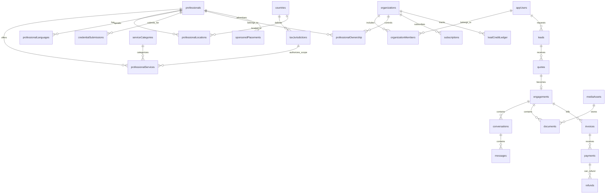

# DATABASE.md — TaxAccountant.com Data Model

**Status:** Proposed phased Convex schema. Source of truth: `PRD.md` and `ARCHITECTURE.md`. This is **not a PostgreSQL schema**. Changes from the master plan require approval. All collections below are planned entities; **only Phase 1 collections are created initially**.

## 1. Technology and type conventions

- **Database:** Convex document-relational database. Collection IDs are native `Id<"collection">` values; `_id` and `_creationTime` are automatically present. There are **no SQL tables, foreign-key constraints or SQL row-level security policies**.
- Type shorthand: `str` string, `num` number, `bool` boolean, `ref(collection)` Convex ID, `str[]` array of strings, `ref[]` references array, `obj` validated structured object, `enum(...)` fixed union, `opt(T)` optional, `nullable(T)` optional explicit null.
- Time: UTC epoch milliseconds (`num`) for app timestamps; timestamp formatting happens at edges. Money: **integer minor units** (`num`) with three-letter ISO currency (`str`); never floats for amounts.
- IDs use native Convex IDs. Uniqueness is ensured with guarded server mutations and indexes, not by assuming SQL UNIQUE/FK machinery exists. Indexes are explicitly declared for real queries.
- Every write checks authorization and referenced record existence. Delete/tombstone cascades are explicit workflow rules. Do not trust browser-supplied owner/user IDs.
- **Better Auth identities, accounts and sessions belong to its Convex component**. Do not shadow-copy passwords, access tokens or auth session tables in application schema.

## 2. Phase 1 — Required collections

### Geography and taxonomy

| Collection | Fields (besides native `_id`, `_creationTime`) | Key indexes / constraints |
|---|---|---|
| `countries` | `code:str` ISO 3166-1 alpha-2, `name:str`, `defaultLocale:str`, `displayCurrency:str`, `discoverable:bool`, `onboardingEnabled:bool`, `transactionEnabled:bool`, `paymentEnabled:bool`, `status:enum(draft,review,published,disabled)`, `updatedAt:num` | `by_code`; `by_discoverable_status`; unique code via mutation |
| `taxJurisdictions` | `code:str`, `countryId:ref(countries)`, `label:str`, `level:enum(national,state,province,local,other)`, `parentId:opt(ref(taxJurisdictions))`, `active:bool` | `by_country`, `by_code`; ensure parent belongs to compatible country |
| `serviceCategories` | `slug:str`, `name:str`, `summary:str`, `parentId:opt(ref(serviceCategories))`, `sortOrder:num`, `publicationStatus:enum(draft,published,archived)`, `seo:obj` | `by_slug`, `by_publication_status`; slug unique |
| `languages` | `code:str` BCP-47/language identifier, `label:str`, `enabled:bool` | `by_code`; unique canonical language code |

### Professionals and search

| Collection | Fields | Key indexes / constraints |
|---|---|---|
| `professionals` | `slug:str`, `displayName:str`, `kind:enum(individual,firm)`, `firmName:opt(str)`, `bio:str`, `approvedProfile:bool`, `verificationStatus:enum(not_reviewed,pending,verified,rejected,expired)`, `publicationStatus:enum(draft,review,published,suspended,archived)`, `remoteServices:bool`, `publicContactMode:enum(contact_form,external,none)`, `featured:bool`, `sourceApprovalRef:opt(str)`, `updatedAt:num` | `by_slug`, `by_publication_status`, `by_featured`; only approved + published shown, `verified` only if check performed |
| `professionalServices` | `professionalId:ref(professionals)`, `serviceId:ref(serviceCategories)`, `taxJurisdictionId:ref(taxJurisdictions)`, `enabled:bool`, `description:opt(str)`, `remote:bool` | `by_professional`, `by_service_jurisdiction`, `by_jurisdiction_service`; prevent duplicate active triplets |
| `professionalLocations` | `professionalId:ref(professionals)`, `countryId:ref(countries)`, `city:str`, `region:opt(str)`, `publicLocationText:opt(str)`, `isPrimary:bool` | `by_professional`, `by_country_city`; no private street address exposed unless approved |
| `professionalLanguages` | `professionalId:ref(professionals)`, `languageId:ref(languages)` | `by_professional`, `by_language`; unique pairing via mutation |
| `professionalPublicCredentials` | `professionalId:ref(professionals)`, `designation:str`, `issuer:opt(str)`, `jurisdictionId:opt(ref(taxJurisdictions))`, `publicDisplayStatus:enum(unverified,verified,expired)`, `reviewedAt:opt(num)`, `reviewedBy:opt(str)`, `sourceRef:opt(str)` | `by_professional`; production verified requires documentary review record; expanded private review Phase 2 |

**Public directory contract:** combine only published professionals with their enabled approved service/jurisdiction links; country location and authorization must remain distinct. An optional **derived search document/index** may be added after the search spike, with a reconciliation process from these source collections. Do not create unbounded arrays of customer data in profile documents.

### CMS and public messages

| Collection | Fields | Key indexes / constraints |
|---|---|---|
| `contentPages` | `slug:str`, `kind:enum(page,blog,guide,glossary,country_service,city_service)`, `title:str`, `summary:opt(str)`, `body:obj` structured safe rich text, `countryId:opt(ref(countries))`, `serviceId:opt(ref(serviceCategories))`, `locale:str`, `seo:obj`, `status:enum(draft,review,published,archived)`, `authorSubject:opt(str)`, `reviewerSubject:opt(str)`, `publishedAt:opt(num)`, `updatedAt:num` | `by_slug_locale`, `by_kind_status`, `by_country_kind`; block duplicate route slug + locale |
| `contentCategories` | `slug:str`, `label:str`, `kind:enum(resource,blog,guide)`, `sortOrder:num` | `by_slug_kind`; idempotent seeds |
| `contentPageCategories` | `pageId:ref(contentPages)`, `categoryId:ref(contentCategories)` | `by_page`, `by_category`; unique pair via mutation |
| `mediaAssets` | `objectKey:str`, `bucketClass:enum(public_media,private)`, `ownerSubject:opt(str)`, `contentType:str`, `sizeBytes:num`, `altText:opt(str)`, `scanStatus:enum(pending,clean,blocked,not_required)`, `approvalStatus:enum(draft,approved,rejected)`, `visibility:enum(private,public)`, `uploadedAt:num` | `by_object_key`, `by_owner`, `by_approval_visibility`; only approved marketing media public |
| `siteSettings` | `key:str`, `value:obj`, `updatedAt:num`, `updatedBySubject:opt(str)` | `by_key`; whitelist configurable keys, no secrets in values |
| `publicMessages` | `kind:enum(contact,professional_interest)`, `name:str`, `email:str`, `phone:opt(str)`, `subject:opt(str)`, `serviceId:opt(ref(serviceCategories))`, `message:str`, `consentVersion:str`, `sourcePath:str`, `status:enum(new,reviewing,closed,spam)`, `createdAt:num`, `updatedAt:num` | `by_kind_status_created`, `by_created`; sensitive read restricted to assigned staff |
| `auditEvents` | `actorSubject:opt(str)`, `actorRole:str`, `action:str`, `resourceType:str`, `resourceId:str`, `metadata:obj` redacted, `createdAt:num` | `by_resource`, `by_actor_created`, `by_created`; append-only, retention policy |

**CMS editorial staff mapping (Phase 1 minimum):** `staffMemberships`: `authSubject:str`, `role:enum(cms_admin,cms_editor)`, `active:bool`, `invitedBy:opt(str)`, `updatedAt:num`; index `by_auth_subject`, role unique per subject. Better Auth still owns actual identity/session fields.

### Phase 1 invariants
- An indexable profile requires approved source/consent and `publicationStatus=published`; a verified badge additionally requires `verificationStatus=verified` and reviewed evidence.
- `country.discoverable` controls whether landing/profile links may appear; `transactionEnabled/paymentEnabled` **never inferred** from discoverable status.
- Unpublished content is inaccessible in anonymous queries even when a slug is guessed.
- All `mediaAssets.objectKey` references resolve to the correct R2 bucket; don't mark uploaded until object verification succeeds.
- `publicMessages` excludes tax IDs, bank data and attached tax files by policy and validation.

## 3. Phase 2 — Accounts, firms and verification

| Collection | Required fields / relationships | Indexes / access |
|---|---|---|
| `appUsers` | `authSubject:str`, `displayName:opt(str)`, `accountStatus:enum(active,suspended,deletion_requested)`, `createdAt:num` | unique `by_auth_subject`; user reads own row; operator access limited |
| `organizations` | `name:str`, `kind:enum(customer_business,professional_firm)`, `ownerUserId:ref(appUsers)`, `status:enum(active,suspended)`, `createdAt:num` | `by_owner`; org metadata only to member/approved public fields |
| `organizationMembers` | `organizationId:ref(organizations)`, `userId:ref(appUsers)`, `role:enum(owner,admin,member,viewer)`, `status:enum(invited,active,removed)` | `by_org`, `by_user`, unique org/user pair |
| `professionalOwnership` | `professionalId:ref(professionals)`, `organizationId:ref(organizations)`, `status:enum(pending,approved,revoked)` | `by_professional`, `by_org`; only approved org edits own profile |
| `credentialSubmissions` | `professionalId:ref(professionals)`, `submittedByUserId:ref(appUsers)`, `designation:str`, `jurisdictionId:ref(taxJurisdictions)`, `mediaAssetId:ref(mediaAssets)`, `expiryAt:opt(num)`, `status:enum(submitted,reviewing,approved,rejected,expired)`, `submittedAt:num` | `by_professional_status`, `by_status`; private document metadata |
| `verificationChecks` | `submissionId:ref(credentialSubmissions)`, `reviewerUserId:ref(appUsers)`, `decision:enum(approve,reject,request_more)`, `reasonCode:opt(str)`, `checkedAt:num` | `by_submission`; immutable review history, private notes |
| `favorites` | `userId:ref(appUsers)`, `professionalId:ref(professionals)`, `createdAt:num` | `by_user`, unique pair |
| `savedSearches` | `userId:ref(appUsers)`, `name:opt(str)`, `filters:obj` validated directory filter schema, `createdAt:num` | `by_user` |
| `consentRecords` | `userId:opt(ref(appUsers))`, `subjectKey:opt(str)`, `purpose:enum(analytics,marketing,essential,legal)`, `version:str`, `granted:bool`, `recordedAt:num` | `by_user_purpose`; anonymous consent cookie details per privacy decision |
| `notifications` | `userId:ref(appUsers)`, `kind:str`, `title:str`, `resourceType:opt(str)`, `resourceId:opt(str)`, `readAt:opt(num)`, `createdAt:num` | `by_user_created`, `by_user_read`; no sensitive message body |
| `privacyRequests` | `userId:ref(appUsers)`, `kind:enum(export,delete,correct)`, `status:enum(new,reviewing,fulfilled,rejected)`, `createdAt:num`, `resolvedAt:opt(num)` | `by_user`, `by_status`; deletion subject to legal hold/retention |

MFA factors, credentials, verification tokens and session data remain in Better Auth's approved component. Never expose raw credential evidence through public profile DTOs.

## 4. Phase 3 — Marketplace transactions and protected collaboration

| Collection | Core fields | Indexes / invariants |
|---|---|---|
| `leads` | `customerUserId:ref(appUsers)`, `professionalId:ref(professionals)`, `jurisdictionId:ref(taxJurisdictions)`, `serviceId:ref(serviceCategories)`, `description:str`, `status:enum(new,quoted,engaged,closed,canceled)`, `createdAt:num` | by customer, professional/status; validate permitted jurisdiction and owner |
| `quotes` | `leadId:ref(leads)`, `professionalOrganizationId:ref(organizations)`, `currency:str`, `amountMinor:num`, `scope:str`, `expiresAt:opt(num)`, `status:enum(draft,sent,accepted,declined,expired)` | `by_lead`, `by_org_status`; accepted quote immutable without revision |
| `engagements` | `leadId`, `quoteId`, `customerUserId`, `professionalOrganizationId` (refs), `status:enum(active,completed,canceled,disputed)`, `startedAt:num`, `completedAt:opt(num)` | by customer, organization; both parties authorized |
| `availabilitySlots` | `professionalId:ref(professionals)`, `startsAt:num`, `endsAt:num`, `timezone:str`, `status:enum(open,blocked,booked)` | `by_professional_starts`; collision detection in mutation |
| `appointments` | `engagementId:opt(ref(engagements))`, `customerUserId`, `professionalId`, `startsAt:num`, `endsAt:num`, `timezone:str`, `status:enum(requested,confirmed,canceled,completed)`, `meetingRef:opt(str)` | per user/professional timeline; timezone-aware checks |
| `conversations` | `engagementId:ref(engagements)`, `createdAt:num` | unique per engagement if single thread policy |
| `messages` | `conversationId:ref(conversations)`, `senderUserId:ref(appUsers)`, `body:str`, `sentAt:num` | by conversation/time; no public reads; redact logs |
| `documents` | `engagementId`, `uploadedByUserId` (refs), `mediaAssetId:ref(mediaAssets)`, `documentClass:str`, `scanStatus:enum(pending,clean,blocked)`, `createdAt:num`, `deletedAt:opt(num)` | by engagement; R2 private only, malware scan gate |
| `providerAccounts` | `organizationId:ref(organizations)`, `provider:str`, `externalAccountRef:str`, `countryId:ref(countries)`, `onboardingStatus:str`, `updatedAt:num` | by org/provider; limited operator access |
| `invoices` | `engagementId:ref(engagements)`, `providerInvoiceRef:opt(str)`, `currency:str`, `totalMinor:num`, `status:enum(draft,issued,paid,void,refunded)`, `createdAt:num` | by engagement, provider ref; totals immutable after issue |
| `payments` | `invoiceId:ref(invoices)`, `provider:str`, `externalPaymentRef:str`, `currency:str`, `amountMinor:num`, `status:enum(pending,succeeded,failed,refunded,partially_refunded)`, `updatedAt:num` | unique provider ref, by invoice; webhook source authoritative |
| `refunds` | `paymentId:ref(payments)`, `externalRefundRef:opt(str)`, `amountMinor:num`, `reasonCode:opt(str)`, `status:enum(pending,succeeded,failed)` | by payment, provider-ref idempotency |
| `payouts` | `providerAccountId:ref(providerAccounts)`, `externalPayoutRef:opt(str)`, `currency:str`, `amountMinor:num`, `status:str`, `createdAt:num` | provider reference; enabled markets only |
| `supportCases` | `requesterUserId:ref(appUsers)`, `engagementId:opt(ref(engagements))`, `kind:str`, `status:enum(open,investigating,resolved,closed)`, `createdAt:num` | by requester, status |
| `disputes` | `engagementId:ref(engagements)`, `paymentId:opt(ref(payments))`, `kind:str`, `status:enum(open,review,closed)`, `createdAt:num` | by engagement, status; restricted |
| `reviews` | `engagementId:ref(engagements)`, `authorUserId:ref(appUsers)`, `professionalId:ref(professionals)`, `score:num`, `text:opt(str)`, `status:enum(pending,approved,rejected)`, `createdAt:num` | by professional/status; only eligible completed engagement; score bounds 1–5 |
| `providerEvents` | `provider:str`, `externalEventId:str`, `type:str`, `receivedAt:num`, `processedAt:opt(num)`, `status:enum(pending,processed,failed)`, `errorCode:opt(str)` | unique external event ID per provider; dedup |

Customer tax records remain only in protected Phase 3 workspaces, **never** public search/content/logs/replay. Decide legal retention and country storage restrictions before enabling document access.

## 5. Phase 4 — Monetization and operator accounting

| Collection | Fields | Invariants |
|---|---|---|
| `subscriptionPlans` | `code:str`, `name:str`, `countryId:opt(ref(countries))`, `currency:str`, `priceMinor:num`, `billingInterval:enum(month,year)`, `active:bool` | versioned pricing; country supported |
| `subscriptions` | `organizationId`, `planId` refs, `providerSubscriptionRef:str`, `status:str`, `currentPeriodEnd:num` | provider webhook authoritative |
| `leadCreditBalances` | `organizationId:ref(organizations)`, `balance:num`, `updatedAt:num` | derived/reconciled against ledger |
| `leadCreditLedger` | `organizationId`, `leadId:opt(ref(leads))`, `delta:num`, `reason:enum(purchase,spend,refund,adjustment)`, `idempotencyKey:str`, `createdAt:num` | append-only; prevent negative balance and duplicate key |
| `financeLedgerEntries` | `sourceType:str`, `sourceId:str`, `organizationId:opt(ref(organizations))`, `currency:str`, `amountMinor:num`, `entryType:str`, `createdAt:num` | append-only, balanced posting model approved by finance |
| `sponsoredPlacements` | `professionalId:ref(professionals)`, `countryId:opt(ref(countries))`, `serviceId:opt(ref(serviceCategories))`, `startsAt:num`, `endsAt:num`, `status:enum(draft,active,ended)`, `label:str` | always labeled Sponsored, eligibility checked |
| `moderationCases` | `targetType:str`, `targetId:str`, `reasonCode:str`, `status:str`, `assignedStaffSubject:opt(str)`, `createdAt:num` | action audited; no unreviewed suppressions hidden from operator |

## 6. Phase 5 — Only if requirements justify

- `translations`: `entityType`, `entityId`, `locale`, approved localized fields, editorial status, `reviewedAt`; indexes by entity/locale.
- `marketActivationReviews`: `countryId`, `serviceId?`, `legalApprovalRef`, `credentialPolicyRef`, `paymentEligibility`, `securityReviewRef`, `approvedBy`, `approvedAt`; auditable enablement.
- Search experiment/ranking telemetry: add only after privacy assessment and explicit experiment approval.

## 7. Conceptual ER / relationship map

| Parent | Child relationships | Policy |
|---|---|---|
| countries | taxJurisdictions, professionalLocations, contentPages, sponsoredPlacements | Geography alone never implies professional license |
| professionals | professionalServices, professionalLocations, professionalLanguages, credentialSubmissions, reviews | Published projection strips private source information |
| serviceCategories + taxJurisdictions | professionalServices | Service authorization checked per jurisdiction |
| appUsers | organizationMembers, favorites, savedSearches, privacyRequests, leads | Users see own records or authorized org records |
| organizations | organizationMembers, professionalOwnership, subscriptions, providerAccounts | Explicit membership permissions |
| leads | quotes, engagements | Customer and responding professional org only |
| engagements | conversations, documents, appointments, invoices, disputes | Protected per engagement participant/authorized staff |
| invoices → payments → refunds | payment lifecycle | PSP verified events and financial reconciliation |
| mediaAssets | contentPages / credentialSubmissions / documents | Public vs private bucket strict separation |

### ER diagram (conceptual; Convex references, not SQL foreign keys)

The diagram intentionally spans multiple phases; these collections are **not created all at once**. Each `ref(...)` is validated by server functions, not enforced by a relational foreign-key constraint.

## 8. Authorization instead of SQL RLS

Convex does **not** provide PostgreSQL row-level security; its queries/mutations execute on the server. Each handler must:
1. Determine verified caller identity through the Better Auth/Convex integration or explicitly permit anonymous access.
2. Resolve role and active organization membership from server records.
3. Verify ownership/participant permission to the exact requested resource.
4. Verify jurisdiction/country flags, publication, verification or payment eligibility when applicable.
5. Return an **allowlisted response projection**, never whole private records.

Test role matrix including anonymous, staff-editor, staff-admin, customer A/B, professional A/B, suspended profile and unsupported-country identities.

## 9. Validation, data integrity and lifecycle

- Canonicalize country/language/currency/tax-jurisdiction IDs and slugs; trim/normalize emails via Better Auth; bounded public messages and rich-text sanitization.
- State transition guards: drafts cannot leap to published without staff permission; verified credentials require approval record; `payments.succeeded` only from provider-verified update; scheduled appointments cannot overlap.
- Avoid full document deletion when relationships, disputes or legal retention require keeping a tombstone; perform account deletion according to approved privacy policy.
- Do not store card data; only opaque PSP references and needed invoice amounts.
- Audit administrative profile publication, verification, country activation, paid ranking, user exports and financial changes.

## 10. Migrations and seed data

- **No SQL migration files.** Use version-controlled Convex schema changes, additive rollout and idempotent backfill jobs for existing data. Never introduce an incompatible required field before backfilling old rows.
- Phase 1 seed sets: selected approved countries, tax jurisdictions, languages, service categories; *fictional/test* professionals for local and staging; production profiles require authorized real data and approved claims.
- Differentiate seeds by environment; hard stop against seeding test people into production public directory.
- Maintain scripts to validate missing references, invalid jurisdiction associations, duplicate slugs and orphaned R2 objects.

## 11. Backup, recovery and retention

- Define scheduled Convex export backup (subject to platform capabilities/plan) and encrypted R2 backup/versioning plan; track same snapshot/cutover so files and metadata reconcile.
- Test restoring into a nonproduction environment; document recovery time and acceptable data-loss targets for client approval.
- Email/contact retention, credentials expiry, tax-document retention, legal holds and cross-border storage rules require legal review before relevant feature activation.
- Backups include source code, schema/config and secret recovery procedures, not hardcoded secret values.

## 12. Data-model decisions awaiting approval

- Initial countries, tax jurisdiction granularity and allowed professional designations.
- Profession profile verification ownership/source/consent and firm-vs-individual representation.
- Search index approach when dataset size and typo/facet acceptance are tested.
- Organization multi-user membership policy, document retention/data residency, payment provider and ledger design in later phases.
